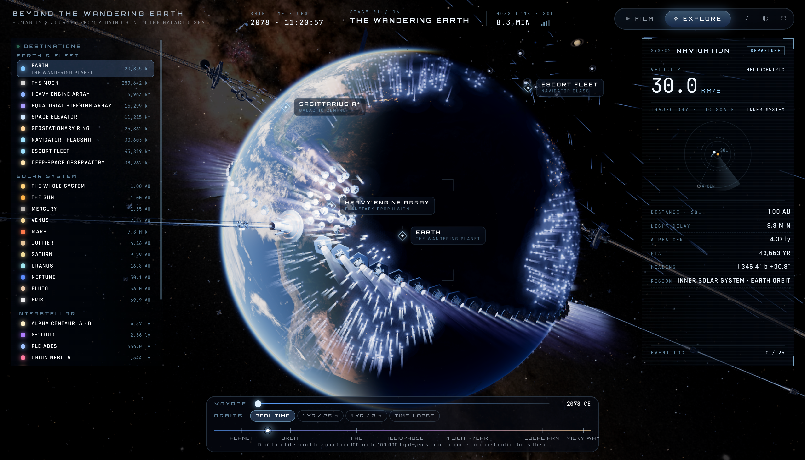
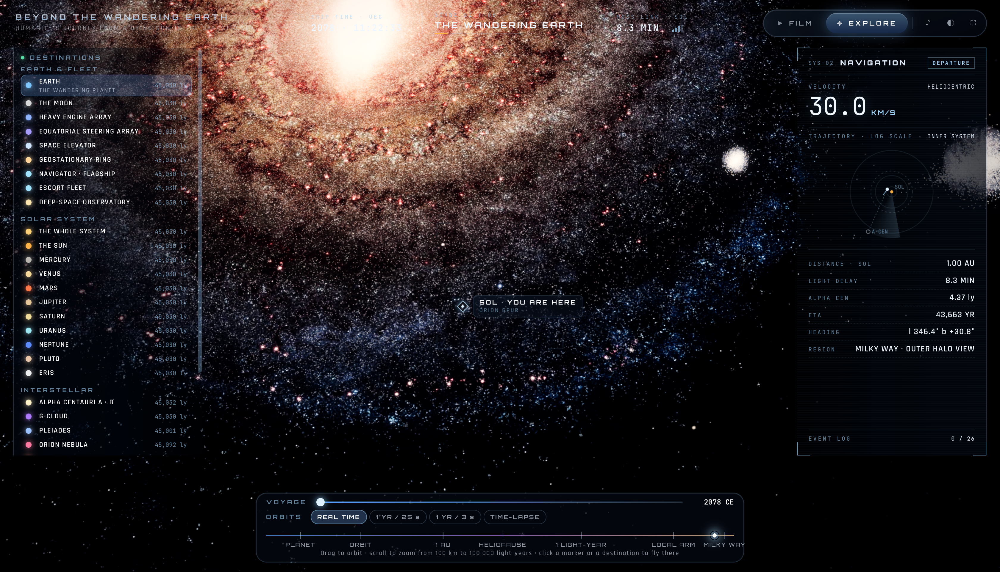
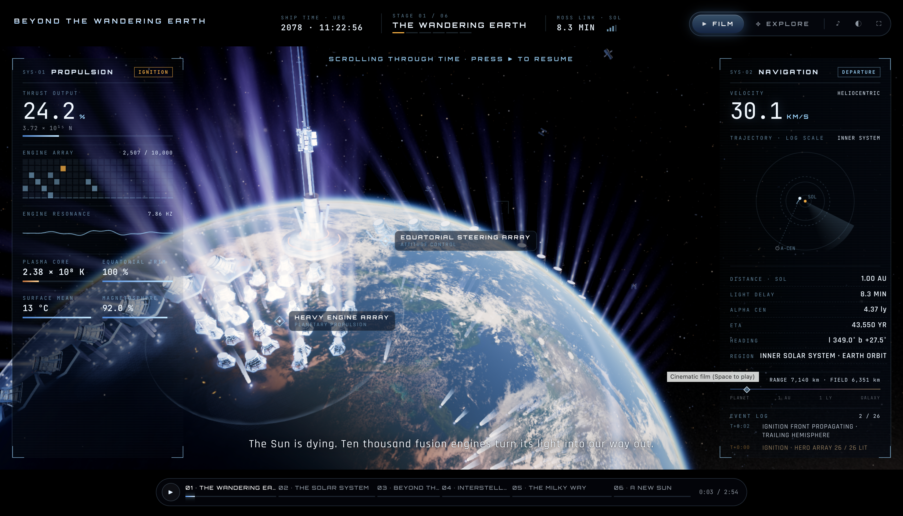
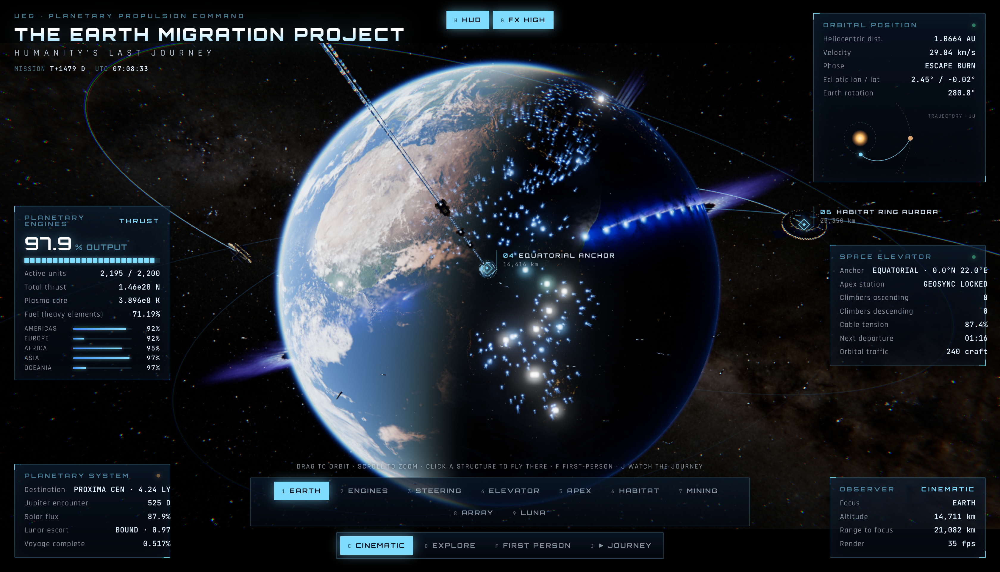
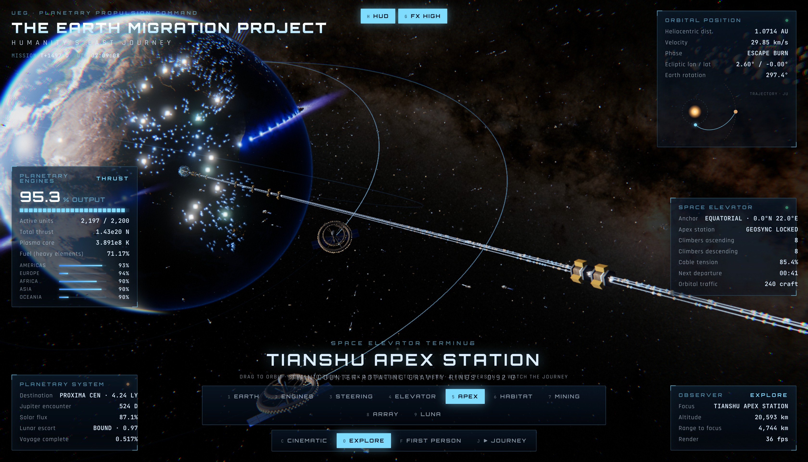
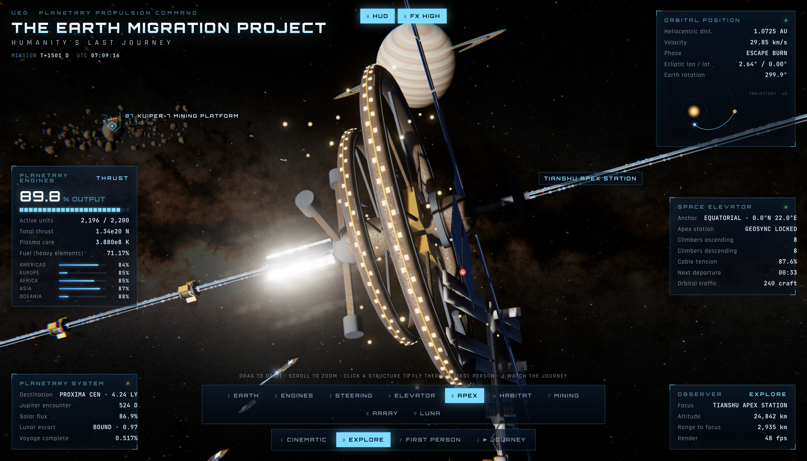
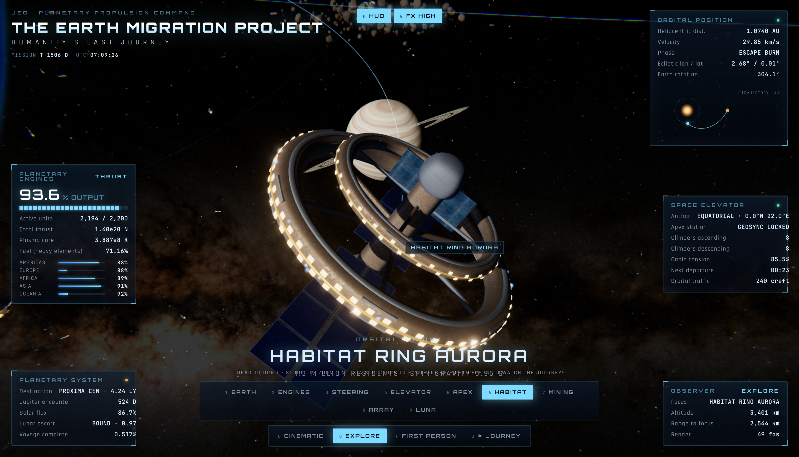
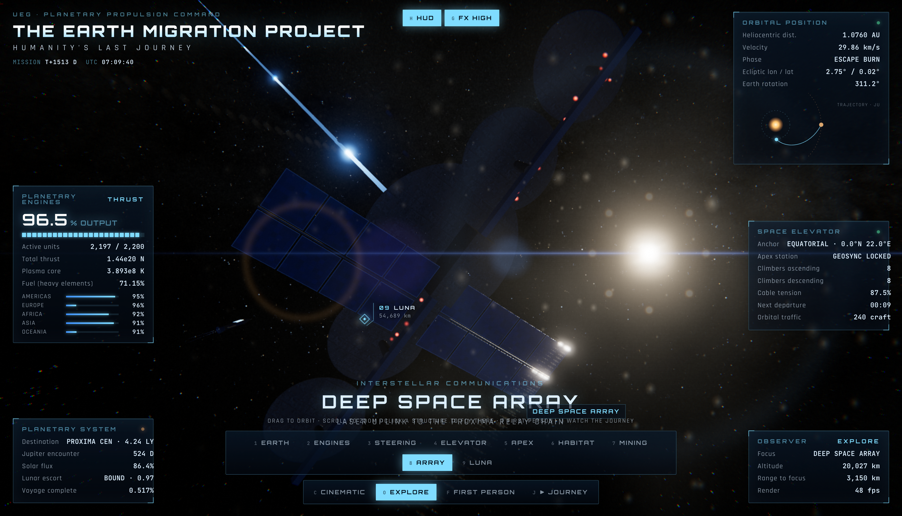
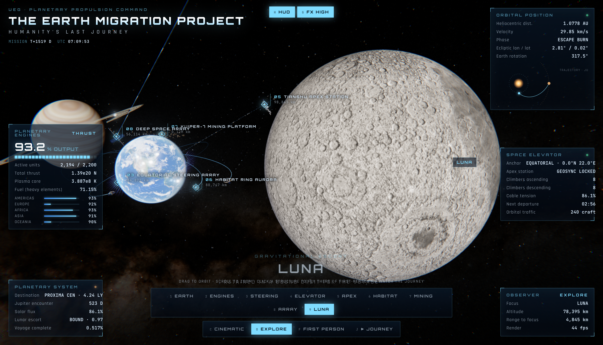

<div align="center">

# 🌍 THE EARTH MIGRATION PROJECT

### 地球迁移计划 · Humanity's Last Journey

基于 **three.js r160** 的电影级交互式 WebGL 体验，献给《流浪地球》：
**第一部** —— 行星发动机、赤道转向阵列、太空电梯，一部地球启程离开太阳系的影片；
**第二部 · Beyond the Wandering Earth（流浪地球 2.0）** —— 从行星发动机到整个银河系，
一条从 100 km 连续拉到 10 万光年的电影级旅程。
A cinematic, interactive WebGL experience built with three.js r160: **Part I** — planetary
engines, a geostationary space elevator and a directed film of Earth leaving the Solar System;
**Part II, Beyond the Wandering Earth** — a continuous cinematic journey from the engines to
the whole Milky Way, zooming from 100 km out to 100,000 light-years.


**[简体中文](#zh) · [English](#en)**

---

## 🤝 友情链接 / Friend Links

| 站点 Site | 链接 Link |
| :--- | :--- |
| 🤖 **Ai 资源网** | <https://human.rlybtd.com/> |

---

## 🖼 壁纸引擎版 / Wallpaper Engine Edition

**流浪地球互动 · 已在 Steam 创意工坊发布** — 真实时 WebGL 动态壁纸，从行星发动机点火，
一路穿过太空电梯、同步轨道环、护航舰队、太阳、木星、土星、星际空间与银河，抵达比邻星的新太阳。
本仓库自带壁纸工程源码与一键打包脚本（见下）。

**Workshop name:** `流浪地球互动 - 泥嚎糕手版 - 桌面右上角切换`

| 项目 Item | 链接 Link |
| :--- | :--- |
| 🎮 **Steam 创意工坊 / Steam Workshop** | <https://steamcommunity.com/sharedfiles/filedetails/?id=3817164734> |

---

## 📸 截图预览 / Screenshots

### 第二部 · Beyond the Wandering Earth（流浪地球 2.0）/ Part II

**① 自由探索 · 目的地导航 / Explore — Destination browser — 地球与发动机群、25 个可飞抵目的地、航程时间轴**



**② 银河视角 · 你在这里 / Galactic view — SOL · YOU ARE HERE — 对数尺度从行星到银河系**



**③ 影片模式 · 全球点火 / Film mode — Global ignition — 10,000 台发动机逐台点亮，推进面板与章节条**



### 第一部 · The Earth Migration Project（经典版）/ Part I

**④ 全球总览 / Global Overview — 行星发动机群、太空电梯与电影视角 HUD**



**⑤ 天枢空间站 / Tianshu Apex Station — 太空电梯同步轨道终点，双反向旋转重力环**



**⑥ 天枢空间站 · 近景 / Tianshu Apex Station, close-up — 背景为土星，远处是柯伊伯-7 采矿平台**



**⑦ 极光号居住环 / Habitat Ring Aurora — 120 万居民的轨道殖民地**



**⑧ 深空通信阵列 / Deep Space Array — 通往比邻星中继链的激光上行链路**



**⑨ 月球 / Luna — 整个旅程中保持束缚轨道的引力护航**



*截图均为原始画质 PNG（3360 × 1924，未压缩），点击图片可查看原图。 · Screenshots are full-quality PNGs (3360 × 1924, uncompressed) — click any image to open the original.*

</div>

---

<a id="zh"></a>

## 🇨🇳 中文说明

### 项目简介

**The Earth Migration Project（地球迁移计划）** 是一个纯前端的**电影级交互式 WebGL 体验**，灵感源自《流浪地球》：太阳即将熄灭，人类在地球上建造了上万台行星发动机，推动整个星球离开太阳系，前往 4.37 光年外的比邻星——一段两千五百年、上百代人的旅程。

程序分为两部，共用同一套渲染与模拟底座：

| | 第一部 · The Earth Migration Project | 第二部 · Beyond the Wandering Earth（流浪地球 2.0） |
| :--- | :--- | :--- |
| 入口 | `index.html` | `beyond.html` |
| 尺度 | 地球轨道（1 单位 ≈ 63.7 km） | **三层尺度阶梯**：行星（63.7 km）→ 太阳系（天文单位）→ 银河（光年），可连续从 100 km 拉到 100,000 光年 |
| 影片 | 约 62 秒 · 六幕（2061 → 第 2500 年） | 约 2 分 54 秒 · 六幕（2078 → 4578 年） |
| 探索 | 9 个地标、第一人称飞行、电影巡航 | 25 个目的地、对数缩放、时间压缩、实时遥测与事件日志 |

全部使用 **three.js r160** 实时渲染，无构建步骤、无 CDN——three.js 与全部资源均已内置，克隆后起一个静态服务器即可运行，**完全可离线**。

### 第一部 · The Earth Migration Project

#### ▶ 观看影片（Watch the Journey）

一部 **约 62 秒的“导演影片”**：六幕分镜、运镜、字幕、程序化配乐与点火音效全部由代码实时驱动，支持暂停 / 拖动进度条 / 跳章。

| 幕 | 标题 | 时间线 | 内容 |
| :--- | :--- | :--- | :--- |
| 01 | The Dying Sun · 垂死的太阳 | 2061 | 太阳急剧膨胀，人类决定带着地球一起走 |
| 02 | Ignition · 点火 | 第 0 年 | 上万台行星发动机逐洲点亮，威尔逊凝聚云穹与地面尘埃环扩散 |
| 03 | Turning the World · 刹住地球 | 第 0 年 · 第 3 天 | 赤道转向发动机启动，地球 45 亿年来第一次停止自转 |
| 04 | The Space Elevator · 太空电梯 | 第 1 年 | 镜头沿 36,000 km 缆绳从赤道一路爬上同步轨道的天枢空间站 |
| 05 | Jupiter · 木星 | 第 17 年 | 借助木星引力弹弓甩出太阳系 |
| 06 | The Long Night · 长夜 | 第 2500 年 | 地球冰封，发动机依旧燃烧，飞向比邻星 |

#### 🧭 自由探索（Explore Freely）

拖拽环绕、滚轮缩放、**点击任意建筑直接飞抵**；数字键 `1`–`9` 一键跳转地标；`F` 进入第一人称飞行；`C` 电影巡航模式（自动环游全部地标）；`O` 返回自由探索。

| 按键 | 地标 | 说明 |
| :--- | :--- | :--- |
| `1` | EARTH · 地球总览 | 行星发动机网络全景 |
| `2` | ENGINE ARRAY 017 · 发动机集群 | 19 台重聚变主发动机，11,000 km 等离子光柱 |
| `3` | EQUATORIAL STEERING ARRAY · 赤道转向阵列 | 环赤道转向发动机，负责停止与调整自转 |
| `4` | EQUATORIAL ANCHOR · 电梯锚点 | 太空电梯赤道地基（0.0°N，22.0°E） |
| `5` | TIANSHU APEX STATION · 天枢空间站 | 电梯同步轨道终点，双反向旋转重力环（0.92 g） |
| `6` | HABITAT RING AURORA · 极光号居住环 | 120 万居民的轨道殖民地（0.95 g 旋转重力） |
| `7` | KUIPER-7 MINING PLATFORM · 柯伊伯-7 采矿平台 | 为聚变发动机开采重元素矿石 |
| `8` | DEEP SPACE ARRAY · 深空通信阵列 | 通往比邻星中继链的激光上行链路 |
| `9` | LUNA · 月球 | 引力护航，全程保持束缚轨道 |

### 第二部 · Beyond the Wandering Earth（流浪地球 2.0）

> 入口：`beyond.html` —— “Part II of The Earth Migration Project”。
> Humanity's Journey from a Dying Sun to the Galactic Sea（从垂死太阳到星辰大海的旅程）。

#### 🎬 影片（约 2 分 54 秒 · 六幕）

| 幕 | 标题 | 时间线 | 内容 |
| :--- | :--- | :--- | :--- |
| 01 | The Wandering Earth · 流浪地球 | 2078 · 地球轨道 1 AU | 全球点火倒计时：10,000 台发动机从尾随半球逐台点亮，150 亿吨推力 |
| 02 | The Solar System · 太阳系 | 2079–2093 · 1 → 10 AU | 穿越木星与土星，土星环面交叉，时间压缩启动 |
| 03 | Beyond the Outer Planets · 超越外行星 | 2101–2156 · 30 → 120 AU | 掠过柯伊伯带、日球层顶，离开太阳的势力范围 |
| 04 | Interstellar Voyage · 星际航行 | 2160–2580 · 0.002 → 1.6 LY | 星际介质、弓形激波、极光；地球成为一颗暗星 |
| 05 | The Milky Way · 银河系 | 猎户臂 · 距银心 26,700 光年 | 拉开到银河全景：旋臂、尘埃带、HII 区与球状星团 |
| 06 | A New Sun · 新的太阳 | 4578 · 比邻星 4.37 LY | 减速点火，抵达新的家园 |

#### 🧭 自由探索

- **25 个目的地**，分三组（地球与舰队 9 · 太阳系 11 · 星际 5），点击列表或标记即可飞抵：
  地球、月球、重型发动机阵列、赤道转向阵列、太空电梯、同步轨道环、领航者旗舰、护航舰队、深空观测站 /
  太阳系全景、太阳、水星、金星、火星、木星、土星、天王星、海王星、冥王星、阋神星 /
  南门二 A·B、G 云、昴星团、猎户座大星云、船底座。
- **对数尺度飞行**：从地表 100 km 连续缩放到 100,000 光年；底部标尺横跨
  `PLANET → ORBIT → 1 AU → HELIOPAUSE → 1 LIGHT-YEAR → LOCAL ARM → MILKY WAY`，点击标尺即可飞到该尺度。
- **时间压缩**：拖动 VOYAGE 时间轴从 2078 滑到 4578 年，公转速度可选
  `REAL TIME / 1 年:25 秒 / 1 年:3 秒 / TIME-LAPSE`。
- **实时遥测**：船钟、阶段/章节进度、MOSS 链路延迟（8.3 分钟，即地日光行时）、速度、与太阳距离、光行时、
  南门二距离、预计抵达年（43,653 年）、银河坐标航向、所在区域，以及 26 条事件日志
  （点火、时间压缩、土星环面交叉、弓形激波稳定、减速点火……）。
- 页面底部有章节条；影片中滚动滚轮可 **穿越时间**（“SCROLLING THROUGH TIME · PRESS ▶ TO RESUME”）。

#### 🪜 三层尺度阶梯（技术核心）

第二部要同时容纳 63.7 km 的地表与 10 万光年的银河，代码把世界分成三层，各自独立模拟、合成到同一个 HDR 画面：

| 层 | 代码 | 尺度 | 内容 |
| :--- | :--- | :--- | :--- |
| L0 地球层 | `js/beyond/earth.js` | 1 单位 ≈ 63.7 km | 缓慢自转并逐渐冰封的地球，尾随半球燃烧着数千台发动机；三座太空电梯升向同步轨道环；舰队、卫星、深空观测站；弓形激波、极光、尘埃流与柯伊伯冰块 |
| L1 太阳系层 | `js/beyond/solar.js` | 艺术化天文单位（轨道半径 2.2·r^0.75 压缩、天体放大） | 剧烈衰老的太阳（米粒组织、黑子、日珥、耀斑与日冕物质抛射）、程序化着色的行星（风暴带、光环）、小行星带与柯伊伯带、带离子尾与尘埃尾的彗星、黄道光、日球层顶，以及地球自己的轨迹 |
| L2 银河层 | `js/beyond/galaxy.js` | 光年（太阳在原点） | 近处是真实星空（NASA SVS Deep Star Maps 银河全景 + 42,000 颗带视差距离的编目恒星，飞过时有 3D 视差）；拉远则交接给与全景对齐的 3D 银河：四旋臂棒旋结构，太阳位于人马臂与英仙臂之间的猎户臂，尘埃带、HII 区、球状星团与麦哲伦云 |

- **合成管线**（`js/beyond/post.js`）：三层先合成进一张多重采样 HDR 帧（只解析一次），再做三个全屏通道——稳定（NaN/Inf 防护 + 热扰动 + 时域稳定）→ 泛光（双滤波 mip 链 + 云隙光）→ 终合（泛光混合 + 镜头效果 + ACES + 调色），比“每层各自 4×MSAA”的老方案省去约 8 个全分辨率通道。
- **硬表面建模**（`js/fx/kit.js` + `js/beyond/craft.js`）：电梯攀爬器、缆绳桁架、中间站、同步环枢纽与领航者级旗舰，全部由几百个基元“拼装”（kitbash）后按材质合并——数百个零件只花几个 draw call。
- **评分音轨**（`js/beyond/audio.js`）：纯 Web Audio 合成——次低音持续音、逐章变化的和弦垫（D 小调 → F 大调 → A 小调 → 降 E 利底亚 → D 大调）、引擎隆隆声、深空微光与揭示时刻的低频轰鸣。

### 🖼 壁纸引擎版（Wallpaper Engine）

已在 **Steam 创意工坊** 发布：**`流浪地球互动 - 泥嚎糕手版 - 桌面右上角切换`**
→ <https://steamcommunity.com/sharedfiles/filedetails/?id=3817164734>

这是第二部的“桌面形态”，同样实时 WebGL 渲染：

- **四种模式**（平滑运镜切换，场景永不重建）：
  `LANDING` 着陆视角——鼠标左右移动在三种设计机位间滑移（也可在控制面板固定机位），停手后缓慢漂移；
  `INSPECT` 检视——环绕发动机、太空电梯、空间站、旗舰、转向阵列、地球、月球、土星或太阳，拖拽旋转、滚轮缩放；
  `CINEMATIC` 电影——面板上按播放才开始的影片，单次播放或无缝循环；
  `FLIGHT` 飞行——沿着影片第一章的航线受引导飞行，鼠标左右控制前进/后退与速度。
- **桌面控制面板**：默认收成右上角一枚小图标，点击展开，点击别处或闲置数秒自动收起；时钟与实时遥测都在壁纸上。
- **30 项壁纸引擎设置**（全部实时生效）：默认模式、循环、交互灵敏度、面板位置/展开/自动收起、闲置回位、巡检自转速度、发动机音频律动反应、生成式音轨与音量、字幕、章节卡、电影黑边、时钟（12/24 小时、四角）、遥测、亮度、画质、帧率上限、省电模式、渲染比例等。
- **四档画质、实时切换**：Low（集成显卡）· Medium（推荐）· High · Ultra；分辨率不足时自动降采样（最低 60%）并降低阴影刷新率，有余量后缓慢恢复。

### 运行方式

ES Modules 与本地资源必须通过 HTTP 访问（直接双击 HTML 无法运行）：

```bash
git clone https://github.com/oxomkbk/earth-migration.git
cd earth-migration
python3 serve.py            # → http://localhost:8080/beyond.html（可指定端口：python3 serve.py 9000）
```

`serve.py` 会直接打开**第二部**；`http://localhost:8080/index.html` 进入**第一部**（第一部页面上也有通往第二部的入口）。其他任意静态服务器也可以，例如 `npx http-server -c-1 .`。

**从源码构建壁纸引擎版**（生成自包含文件夹，可离线、`file://` 运行）：

```bash
npm i esbuild               # 或设置 ESBUILD=/path/to/esbuild
node tools/build-wallpaper.mjs [输出目录]      # 默认输出到仓库外的 ../wandering-earth-wallpaper
```

打包器把 three.js、第二部全部代码与壁纸控制器合并成一个经典脚本，所有图片/模型/音效以 `data:` URI 内嵌（`pack/*.js`），字体也内嵌——因此 Wallpaper Engine 从磁盘打开时无需任何网络请求。构建完成后按 `wallpaper/README.txt` 的说明导入 Wallpaper Engine 并发布。

> 要求：现代桌面浏览器（Chrome / Edge / Firefox / Safari），支持 WebGL2，独立 GPU 体验最佳；移动端会自动切换低画质档位。

### 操作按键

**第一部（`index.html`）**

| 按键 | 作用 |
| :--- | :--- |
| 鼠标拖拽 / 滚轮 | 环绕 / 缩放 |
| 点击建筑 | 飞往该结构 |
| `1` – `9` | 跳转地标 |
| `C` / `O` / `F` | 电影巡航 / 自由探索 / 第一人称 |
| 第一人称：`W A S D` + `E`/`Space` 升 + `Q`/`Ctrl` 降，`Shift` 加速，`Esc` 退出 | |
| `J` | 播放整部影片 |
| `H` / `G` | 隐藏 HUD / 切换重特效 |
| 影片中：`Space` 暂停 · `←`/`→` 跳章 · `M` 声音 · `Esc` 退出 | |

**第二部（`beyond.html`）**

| 按键 | 作用 |
| :--- | :--- |
| 鼠标拖拽 / 滚轮 | 环视 / 缩放（从 100 km 到 100,000 光年） |
| 点击目的地 / 标记 | 飞往该处 |
| 滚轮（影片中） | 穿越时间 |
| `Space` | 播放 / 暂停影片 |
| `F` | 自由相机 |
| `M` / `H` | 声音 / 隐藏仪表盘 |
| 底部章节条 | 跳章、拖动进度 |

### 目录结构

| 路径 | 说明 |
| :--- | :--- |
| `index.html` · `css/app.css` · `js/app.js` | **第一部**：页面外壳、样式与全部主逻辑 |
| `beyond.html` · `css/beyond.css` | **第二部**（流浪地球 2.0）页面外壳与样式 |
| `js/beyond/main.js` | 第二部入口：渲染器、三层尺度阶梯、影片/自由相机、交互、HUD 与音频 |
| `js/beyond/earth.js` | L0 地球层：发动机、电梯、同步环、舰队、星际航行特效 |
| `js/beyond/solar.js` | L1 太阳系层：衰老的太阳、行星、小行星/柯伊伯带、彗星、日球层顶 |
| `js/beyond/galaxy.js` | L2 银河层：真实星表 + 3D 银河（旋臂、尘埃带、HII 区、麦哲伦云） |
| `js/beyond/story.js` | 六幕影片的章节、镜头与字幕脚本 |
| `js/beyond/dash.js` | 仪表盘：任务条、导航遥测、目的地列表、事件日志、航程时间轴 |
| `js/beyond/craft.js` | 英雄资产：攀爬器、桁架、枢纽站、领航者旗舰（拼装建模） |
| `js/beyond/post.js` | 合成与后期：三层 HDR 合成、稳定、泛光、ACES 终合 |
| `js/beyond/audio.js` | 生成式配乐（纯 Web Audio） |
| `js/beyond/util.js` | 尺度换算与数学工具 |
| `js/fx/kit.js` | 拼装建模（kitbash）：数百基元合并为少量 draw call |
| `js/fx/triplanar.js` | 无 UV 几何体的三平面 PBR + 窗口灯光 |
| `js/fx/volplume.js` | 体积等离子光柱（ray-marching） |
| `js/fx/smoke.js` | 导流槽尾烟与光柱蒸汽 |
| `js/fx/shock.js` | 点火冲击波（凝聚云穹 + 尘埃环） |
| `js/fx/atmosphere.js` | Rayleigh + Mie 散射大气（弧光 / 晨昏线 / 天空） |
| `js/fx/aerial.js` | 行星尺度空气透视（所有受光材质的大气雾） |
| `js/fx/models.js` | glTF / Draco 加载与 NASA 模型实例化 |
| `js/wallpaper/` | 壁纸引擎桥接：入口打包、资源钩子（data: URI）、控制器（四种模式与 30 项设置）、着陆视角 |
| `wallpaper/` | 壁纸引擎工程源（`project.json`、预览图、字体、样式、说明） |
| `tools/build-wallpaper.mjs` | 一键打包自包含壁纸文件夹（esbuild） |
| `vendor/three/` | three.js r160 构建与用到的 addons（无需 CDN） |
| `assets/planets/` | 太阳系天体贴图（Solar System Scope，CC BY 4.0） |
| `assets/` | 星空、贴图与模型（见致谢） |
| `screenshot/` | README 截图（原始画质） |
| `tools/convert-sky.html` | 一次性转换工具：NASA EXR 星图 → `assets/sky/` |

---

<a id="en"></a>

## 🇬🇧 English

### About

**The Earth Migration Project** is a fully front-end, **cinematic interactive WebGL experience** inspired by *The Wandering Earth*. It ships in two parts sharing one rendering and simulation core:

| | Part I · The Earth Migration Project | Part II · Beyond the Wandering Earth |
| :--- | :--- | :--- |
| Entry | `index.html` | `beyond.html` |
| Scale | Earth orbit (1 unit ≈ 63.7 km) | **Three-layer scale ladder**: planet (63.7 km) → Solar System (AU) → galaxy (light-years), a continuous zoom from 100 km to 100,000 ly |
| Film | ~62 s · six chapters (2061 → Year 2500) | ~2:54 · six chapters (2078 → 4578) |
| Explore | 9 landmarks, first-person flight, cinematic tour | 25 destinations, log-scale flight, time compression, live telemetry and an event log |

Everything is rendered in real time with **three.js r160**. No build step, no CDN — three.js and every asset are vendored, so cloning the repo and starting any static server is enough. **Works fully offline.**

### Part I · The Earth Migration Project

#### ▶ Watch the Journey

A **~62-second directed film**: six chapters of camera work, subtitles, a procedural score and ignition SFX — all driven by code in real time. Pause, scrub and skip chapters at will (chapter table: *The Dying Sun → Ignition → Turning the World → The Space Elevator → Jupiter → The Long Night*, see the Chinese section above).

#### 🧭 Explore Freely

Drag to orbit, scroll to zoom, **click any structure to fly there**; keys `1`–`9` jump between nine landmarks (Earth overview, Engine Array 017, Equatorial Steering Array, Equatorial Anchor, Tianshu Apex Station, Habitat Ring Aurora, Kuiper-7 Mining Platform, Deep Space Array, Luna). `F` enters first-person flight, `C` is an automatic cinematic tour, `O` returns to free exploration.

### Part II · Beyond the Wandering Earth

> Entry: `beyond.html` — “Part II of The Earth Migration Project”.
> *Humanity's Journey from a Dying Sun to the Galactic Sea.*

#### 🎬 The film (~2:54, six chapters)

| # | Chapter | Timeline | What happens |
| :--- | :--- | :--- | :--- |
| 01 | The Wandering Earth | 2078 · Earth orbit, 1 AU | The global ignition countdown: 10,000 engines light up one by one across the trailing hemisphere — 150 billion tonnes of thrust |
| 02 | The Solar System | 2079–2093 · 1 → 10 AU | Past Jupiter and Saturn, a ring-plane crossing, time compression engages |
| 03 | Beyond the Outer Planets | 2101–2156 · 30 → 120 AU | Through the Kuiper belt and across the heliopause, leaving the Sun's domain |
| 04 | Interstellar Voyage | 2160–2580 · 0.002 → 1.6 LY | The interstellar medium, bow shock and aurora; Earth becomes a dark star |
| 05 | The Milky Way | Orion Spur · 26,700 ly from the galactic centre | Pulling back to the whole galaxy: spiral arms, dust lanes, HII regions and globular clusters |
| 06 | A New Sun | 4578 · Alpha Centauri, 4.37 LY | The deceleration burn — arrival at a new home |

#### 🧭 Explore

- **25 destinations** in three groups (Earth & Fleet 9 · Solar System 11 · Interstellar 5) — click a list entry or a marker to fly there: Earth, the Moon, the Heavy Engine Array, the Equatorial Steering Array, the Space Elevator, the Geostationary Ring, the Navigator flagship, the escort fleet, the deep-space observatory / the whole system, the Sun, Mercury, Venus, Mars, Jupiter, Saturn, Uranus, Neptune, Pluto, Eris / Alpha Centauri A·B, the G-Cloud, the Pleiades, the Orion Nebula, Carina.
- **Log-scale flight**: a continuous zoom from 100 km above the surface to 100,000 light-years; the bottom ruler spans `PLANET → ORBIT → 1 AU → HELIOPAUSE → 1 LIGHT-YEAR → LOCAL ARM → MILKY WAY` and clicking it flies to that scale.
- **Time compression**: drag the VOYAGE timeline from 2078 to 4578, with orbit speeds `REAL TIME / 1 yr : 25 s / 1 yr : 3 s / TIME-LAPSE`.
- **Live telemetry**: ship clock, stage/chapter progress, MOSS link latency (8.3 min — the one-way light time from Sol), velocity, distance from Sol, light delay, Alpha Centauri distance, ETA (year 43,653), galactic heading, region, and a 26-entry event log (ignition, time compression, ring-plane crossing, bow shock stable, deceleration burn…).
- A chapter strip sits at the bottom; during the film, scrolling the wheel **travels through time** (“SCROLLING THROUGH TIME · PRESS ▶ TO RESUME”).

#### 🪜 The three-layer scale ladder

To hold both a 63.7 km surface and a 100,000 ly galaxy, the world is split into three layers, each simulated independently and composited into one HDR frame:

| Layer | Code | Scale | Contents |
| :--- | :--- | :--- | :--- |
| L0 Earth | `js/beyond/earth.js` | 1 unit ≈ 63.7 km | A slowly turning, freezing Earth whose trailing hemisphere burns with thousands of engines; three space elevators rising to a geostationary ring; fleets, satellites and a deep-space observatory; bow shock, aurora, dust streaks and Kuiper ice shards |
| L1 Solar System | `js/beyond/solar.js` | “art-AU” (orbit radii compressed as 2.2·r^0.75, bodies enlarged) | A violent, ageing Sun (granulation, sunspots, prominence loops, flares and a coronal mass ejection), procedurally shaded planets with storm bands and rings, the asteroid and Kuiper belts, comets with ion and dust tails, zodiacal dust, the heliopause, and the Wandering Earth's own trajectory |
| L2 Galaxy | `js/beyond/galaxy.js` | Light-years (Sun at the origin) | Up close the sky is the real one (NASA SVS Deep Star Maps panorama + 42,000 catalogue stars given plausible parallax distances); pulling back hands over to a 3D Milky Way registered to the panorama — a barred four-arm spiral with the Sun in the Orion Spur, dust lanes, HII regions, globular clusters and the Magellanic Clouds |

- **Compositing pipeline** (`js/beyond/post.js`): the three layers resolve once into a single multisampled HDR frame, then three full-screen passes — stabilise (NaN/Inf guard + heat haze + temporal stabiliser) → bloom (dual-filter mip chain + crepuscular rays) → final (bloom composite + lens + ACES + grade) — replacing what used to be ~8 full-resolution MSAA half-float passes.
- **Hard-surface modelling** (`js/fx/kit.js` + `js/beyond/craft.js`): the elevator climber, tether truss, waystations, ring hub stations and the Navigator-class flagship are kitbashed from hundreds of primitives and merged per material — hundreds of parts cost a handful of draw calls.
- **Generative score** (`js/beyond/audio.js`): pure Web Audio — a sub-bass drone, a chord pad that changes per chapter (D minor → F major 7 → A minor → E♭ lydian → D major), engine rumble, deep-space shimmer and low booms on the big reveals.

### 🖼 Wallpaper Engine edition

Published on the **Steam Workshop**: **`流浪地球互动 - 泥嚎糕手版 - 桌面右上角切换`**
→ <https://steamcommunity.com/sharedfiles/filedetails/?id=3817164734>

The desktop form of Part II, also rendered live in WebGL:

- **Four modes** (eased camera flights; the scene is never rebuilt): `LANDING` — the Earth and its engines, three designed views chosen by the cursor (or pinned), slow drift when idle; `INSPECT` — orbit the engines, elevator, station, flagship, steering array, Earth, Moon, Saturn or Sun (drag to orbit, wheel to zoom); `CINEMATIC` — the film, which plays only from the panel's Play control, one-shot or seamless loop; `FLIGHT` — a guided flight along the film's chapter-1 path where the cursor sets speed and direction.
- **On-screen control panel** at the top edge (top right by default): collapsed to a small dim icon, opens on click, closes on click-outside or after a few seconds. Clock and telemetry live on the wallpaper.
- **30 Wallpaper Engine properties**, all applied live: default mode, loop, interaction sensitivity, panel open/collapse/position/offset, idle return, inspect auto-rotate, audio-reactive engines, generative soundtrack and volume, captions, chapter cards, letterbox, clock (12/24 h, four corners), telemetry, brightness, quality, frame-rate cap, power saver, render scale.
- **Four quality tiers, switched live**: Low (integrated graphics) · Medium (recommended) · High · Ultra. If frames arrive late the wallpaper lowers its own resolution (down to 60 %), then refreshes the shadow map less often, and recovers slowly when there is headroom.

### Run it

ES modules and local assets must be served over HTTP (opening the HTML from disk will not work):

```bash
git clone https://github.com/oxomkbk/earth-migration.git
cd earth-migration
python3 serve.py            # → http://localhost:8080/beyond.html  (custom port: python3 serve.py 9000)
```

`serve.py` opens **Part II** directly; `http://localhost:8080/index.html` is **Part I** (which links on to Part II). Any static server works too, e.g. `npx http-server -c-1 .`

**Building the Wallpaper Engine edition from source** (self-contained folder, offline, `file://`):

```bash
npm i esbuild               # or set ESBUILD=/path/to/esbuild
node tools/build-wallpaper.mjs [outDir]     # defaults to ../wandering-earth-wallpaper, outside the repo
```

The bundler merges three.js, all of Part II and the wallpaper controller into one classic script, and inlines every image/model/sound as `data:` URIs (`pack/*.js`) plus the fonts — so Wallpaper Engine needs no network access at all. Then follow `wallpaper/README.txt` to import and publish.

> Requires a modern desktop browser with WebGL2 (a discrete GPU is recommended); mobile devices automatically switch to a lower quality profile.

### Controls

**Part I (`index.html`)**

| Input | Action |
| :--- | :--- |
| Drag / scroll | Orbit / zoom |
| Click a structure | Fly there |
| `1` – `9` | Jump to a landmark |
| `C` / `O` / `F` | Cinematic tour / Explore / First person |
| First person: `W A S D`, `E`/`Space` up, `Q`/`Ctrl` down, `Shift` sprint, `Esc` exit | |
| `J` | Play the film |
| `H` / `G` | Hide HUD / toggle heavy effects |
| In the film: `Space` pause · `←`/`→` chapters · `M` sound · `Esc` exit | |

**Part II (`beyond.html`)**

| Input | Action |
| :--- | :--- |
| Drag / scroll | Look around / zoom (from 100 km to 100,000 ly) |
| Click a destination / marker | Fly there |
| Wheel (during the film) | Travel through time |
| `Space` | Play / pause the film |
| `F` | Free camera |
| `M` / `H` | Sound / hide the dashboards |
| Chapter strip (bottom) | Skip chapters, scrub |

### Project layout

| Path | What |
| :--- | :--- |
| `index.html` · `css/app.css` · `js/app.js` | **Part I**: page shell, styles and all main logic |
| `beyond.html` · `css/beyond.css` | **Part II** (Beyond the Wandering Earth) shell and styles |
| `js/beyond/main.js` | Part II entry: renderer, three-layer scale ladder, film/free camera, interaction, HUD and audio |
| `js/beyond/earth.js` | L0 Earth layer: engines, elevators, geostationary ring, fleets, interstellar-voyage effects |
| `js/beyond/solar.js` | L1 Solar System layer: the ageing Sun, planets, belts, comets, heliopause |
| `js/beyond/galaxy.js` | L2 Galaxy layer: real star catalogue + a 3D Milky Way (arms, dust lanes, HII regions, Magellanic Clouds) |
| `js/beyond/story.js` | The six-chapter film: chapters, camera work and subtitles |
| `js/beyond/dash.js` | Dashboards: mission strip, navigation telemetry, destinations, event log, voyage timeline |
| `js/beyond/craft.js` | Hero assets: climber, truss, hub stations, Navigator flagship (kitbashed) |
| `js/beyond/post.js` | Compositing and post: three-layer HDR composite, stabiliser, bloom, ACES final |
| `js/beyond/audio.js` | Generative score (pure Web Audio) |
| `js/beyond/util.js` | Scale conversions and math utilities |
| `js/fx/kit.js` | Kitbashing: hundreds of primitives merged into a few draw calls |
| `js/fx/triplanar.js` | triplanar PBR for UV-less geometry + window lights |
| `js/fx/volplume.js` | ray-marched volumetric plasma plumes |
| `js/fx/smoke.js` | flame-trench exhaust clouds and plume steam |
| `js/fx/shock.js` | ignition shockwave (condensation dome + dust ring) |
| `js/fx/atmosphere.js` | Rayleigh + Mie atmosphere (limb / terminator / sky) |
| `js/fx/aerial.js` | planet-aware aerial perspective on all lit materials |
| `js/fx/models.js` | glTF/Draco loading and instancing of the NASA models |
| `js/wallpaper/` | Wallpaper Engine bridge: bundle entry, data-URI asset hook, controller (four modes, 30 properties), landing view |
| `wallpaper/` | Wallpaper Engine project source (`project.json`, preview, fonts, styles, notes) |
| `tools/build-wallpaper.mjs` | One-command build of the self-contained wallpaper folder (esbuild) |
| `vendor/three/` | three.js r160 build + the addons used (no CDN needed) |
| `assets/planets/` | Solar System body maps (Solar System Scope, CC BY 4.0) |
| `assets/` | sky, textures and models (see credits) |
| `screenshot/` | README screenshots (full quality) |
| `tools/convert-sky.html` | one-off converter: NASA EXR star maps → `assets/sky/` |

---

## 📄 素材来源与致谢 / Credits

- **Sky 星空**： NASA/Goddard Space Flight Center Scientific Visualization Studio, *Deep Star Maps 2020* (Gaia DR2, Hipparcos-2, Tycho-2) — public domain. 银河全景与星表由 `milkyway_2020_4k.exr` 和 `hiptyc_2020_8k.exr` 派生。银河系俯视图 / Milky Way plan view: NASA Goddard / CI Lab — public domain (`assets/sky/milkyway_top_2k.jpg`).
- **Planet maps 行星贴图**（第二部）： Solar System Scope (solarsystemscope.com/textures) — CC BY 4.0 (`assets/planets/`). Pluto: NASA/JHUAPL/SwRI — public domain.
- **Models 模型**： NASA 3D Resources (github.com/nasa/NASA-3D-Resources) — International Space Station (B), Hubble Space Telescope (A), Mobile Launcher. Public domain; NASA does not endorse this project.
- **Textures 贴图**： Poly Haven (polyhaven.com) — metal_plate_02, painted_metal_shutter, gray_rocks, blue_metal_plate, aerial_ground_rock. CC0.
- **Earth / Moon maps 地月贴图**： three.js example textures (NASA Blue Marble / Black Marble derived), MIT-licensed repository, vendored in `assets/earth/`; a procedural planet is generated if they fail to load.
- **Fonts 字体**： Orbitron, Rajdhani, JetBrains Mono (SIL Open Font License 1.1).
- **声明**：本作品是受《流浪地球》启发的同人创作（fan work），与权利方无关联。 / A fan work inspired by *The Wandering Earth*; not affiliated with its rights holders.

<div align="center">

🤝 友情链接 / Friend Links: **[Ai 资源网](https://human.rlybtd.com/)**

🖼 壁纸引擎版 / Wallpaper Engine: **[Steam 创意工坊 / Steam Workshop](https://steamcommunity.com/sharedfiles/filedetails/?id=3817164734)**

</div>
